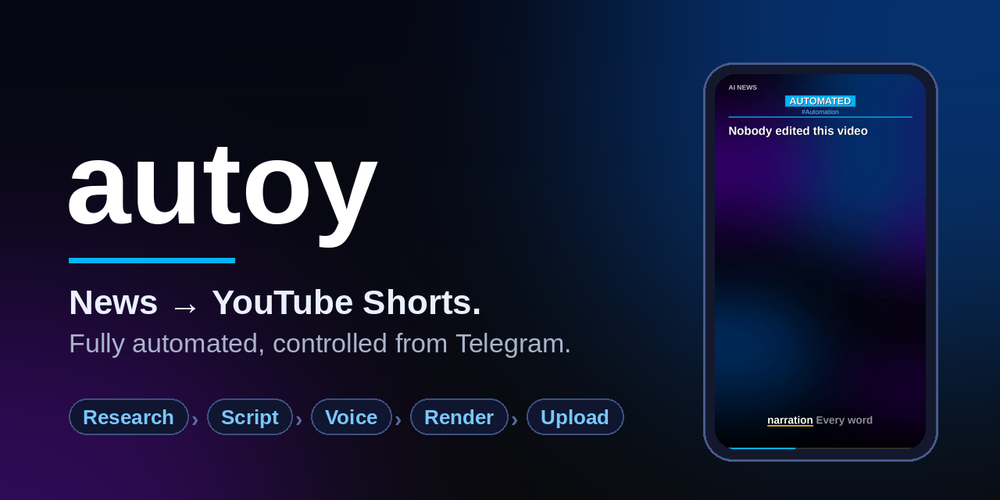
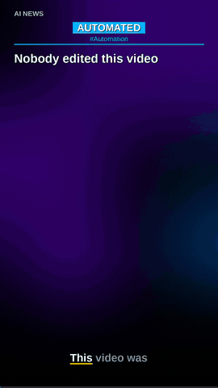
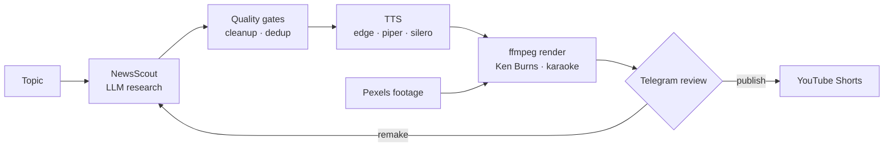

<div align="center">



# autoy

**Autonomous news-to-video pipeline.** It picks a topic, researches the story, writes a 30-second script, voices it with a neural TTS, renders a vertical video with karaoke subtitles, and uploads it to YouTube Shorts — several times a day, per channel, with a Telegram bot as the control panel.

[](https://github.com/kuanysh228/autoy/actions/workflows/ci.yml)
[](pyproject.toml)
[](LICENSE)
[](https://github.com/astral-sh/ruff)



<sub>Rendered by <a href="examples/render_demo.py"><code>examples/render_demo.py</code></a> — real renderer and neural voice, generated backgrounds.</sub>

</div>

---

## Features

- **Multi-channel.** Each channel is a declarative profile: language, topics, accent colour, hashtags, weekly rundown, its own OAuth credentials. Five ready-made profiles ship in the box; add your own in a TOML file.
- **Script quality gates.** Technical junk, URLs, source references and LLM filler are stripped. Scripts with weak newswire titles or banned phrases are regenerated; wrong-language output is rejected.
- **Retention-first format.** Hook → 3–5 facts → question → loop line. Audio longer than `MAX_DURATION_SEC` is re-synthesised with middle sentences dropped, keeping the hook and the ending.
- **Renderer.** Ken Burns slideshow over Pexels photos, word-level karaoke subtitles from edge-tts boundaries, power-word highlighting, progress bar and background music mix. Frames are streamed straight into ffmpeg, so nothing touches the disk until the final MP4.
- **Weekly digest.** Parallel story research, per-segment narration, intro/chapter/outro cards, chapter timestamps in the description and a photo-backed thumbnail.
- **Telegram control bot.** `/create`, review mode with Publish / Remake / Delete buttons and a 5-minute auto-approve, a per-slot schedule stored in SQLite, a daily limit, a quota estimate and subscriber/view milestone alerts.
- **Telegram channel auto-posting.** The same research pipeline, formatted as a text post, with its own dedup table.
- **Dedup.** Exact title hash, 12-hour fuzzy title overlap and a 6-hour topic cooldown.
- **Pluggable TTS.** `edge` (default, with gTTS fallback), `piper` and `silero` behind one `Synthesizer` protocol.
- **English and Russian.** Prompts, voices, text normalisation, on-screen text and metadata are localised per channel (`lang = "en"` or `"ru"`).

## How it works



The pipeline objects (`ShortsPipeline.produce()` → `ShortsDraft` → `publish()`) are the only place business flow lives. The CLI, the headless scheduler and the bot are thin adapters over them.

## Requirements

- Python 3.11+
- `ffmpeg` and `ffprobe` on `PATH`
- A TrueType font (defaults to Liberation Sans; override with `FONT_BOLD` / `FONT_REGULAR`)
- [NewsScout](https://github.com/kuanysh228/NewsScout) for research — installed with the `newsscout` extra
- A Google Cloud project with the **YouTube Data API v3** enabled and an OAuth 2.0 desktop client
- Optional: a [Pexels](https://www.pexels.com/api/) key for stock photos, a Telegram bot token

## Quick start

```bash
git clone https://github.com/kuanysh228/autoy.git && cd autoy
python -m venv .venv && source .venv/bin/activate
pip install -e ".[newsscout,dev]"

cp .env.example .env            # fill in tokens and keys
mkdir -p credentials            # put client_secret.json here
autoy authorize world           # one-time OAuth flow per channel
autoy shorts --no-upload        # render a video locally
autoy shorts "Iran nuclear deal news today" --channel world
```

The working directory is the project home (`AUTOY_HOME` overrides it). `credentials/`, `data/`, `cache/` and `output/` live there and are git-ignored.

Want to see the renderer first? No keys needed:

```bash
pip install -e .
python examples/render_demo.py     # writes output/videos/demo.mp4
```

## Channels

Built-in profiles: `world`, `crypto`, `ai`, `business`, `billionaires`.

To add or override channels, copy [`channels.example.toml`](channels.example.toml) to `channels.toml` in the project home:

```toml
default = "tech"

[channels.tech]
name = "TECH DAILY"
lang = "en"
accent = "#00b4ff"
topics = ["smartphone launch news today", "cybersecurity breach news today"]
hashtags = ["tech", "gadgets"]

[[channels.tech.weekly_topics]]
label = "Phones"
query = "smartphone news this week"
pexels_query = "smartphone technology"
```

A key that matches a built-in profile replaces it. `default` is the channel used when none is given. Invalid files fail fast with a message naming the channel and the field.

## CLI

| Command | What it does |
|---|---|
| `autoy shorts [topic] [--channel K] [--no-upload] [--publish-at RFC3339] [--tts edge\|piper\|silero] [--voice ID]` | Produce one Shorts video and upload it |
| `autoy weekly [--channel K] [--topics N] [--no-upload] [--publish-at …]` | Produce the weekly digest |
| `autoy authorize [channel]` | List token status or run the OAuth flow |
| `autoy scheduler [channels…] [--no-weekly] [--no-telegram]` | Headless scheduler (`SCHEDULE_TIMES`, `WEEKLY_TIME`, `TELEGRAM_CHANNEL_TIMES`) |
| `autoy bot` | Telegram control bot with its own DB-backed schedule |
| `autoy tg-post [--topic …] [--dry-run]` | Post one story to the Telegram channel |
| `autoy thumbnail "Title" [--query "pexels query"]` | Render thumbnail variants |
| `autoy analytics` | Per-channel stats for every uploaded video (needs `YOUTUBE_API_KEY`) |

### Bot commands

```
/create [channel] [topic]     produce a video now (review mode → inline buttons)
/schedule_add world 10:00     add a daily slot        /schedule, /schedule_on|off|remove <id>
/review on|off                manual review vs auto-publish (on by default)
/limit [n]                    daily upload limit      /quota   local quota estimate
/weekly, /weekly_set …        digest settings         /weekly_now
/stats [channel]              live subscribers/views  /status  /channels  /help
```

The bot only accepts commands from `TELEGRAM_CHAT_ID`.

## Configuration

Everything is read from the environment, with `.env` in the project home as a fallback. See [`.env.example`](.env.example) for the full list.

| Variable | Purpose |
|---|---|
| `TELEGRAM_BOT_TOKEN`, `TELEGRAM_CHAT_ID` | Bot token and the owner chat |
| `TELEGRAM_CHANNEL_ID`, `TELEGRAM_NEWS_CHANNEL` | Public channel for text posts and which profile feeds it |
| `PEXELS_API_KEY` | Stock photos; without it backgrounds fall back to a gradient |
| `YOUTUBE_API_KEY`, `YOUTUBE_CHANNEL_IDS` | Read-only key for analytics, `key=UC…` pairs for `/stats` and milestones |
| `SCHEDULE_TIMES`, `WEEKLY_TIME`, `WEEKLY_CHANNEL`, `TELEGRAM_CHANNEL_TIMES` | Scheduler slots |
| `MAX_POSTS_PER_DAY`, `MAX_DURATION_SEC`, `SCENE_DURATION_SEC`, `VIDEO_FPS` | Publishing and render limits |

Per-channel OAuth files live in `credentials/`: `client_secret.json` (or the channel's `client_secret_file`) and the generated `<channel>_token.pickle`.

## Project layout

```
src/autoy/
├── cli/            argparse entry point (`autoy …`)
├── config.py       Settings / Paths from env + .env
├── channels.py     built-in channel profiles and the channels.toml loader
├── strings.py      localised on-screen text and metadata templates
├── models.py       NewsItem, WeeklyStory, WordEvent, Voice
├── storage.py      SQLite: PostRegistry (dedup, history) and BotStore (schedule, settings, reviews)
├── dedup.py        topic cooldown and fuzzy title matching
├── text/           voiceover preprocessing and script shaping (pure functions, fully tested)
├── sources/        NewsScout adapter with prompt rules, Google News RSS fallback
├── tts/            Synthesizer protocol, edge / piper / silero backends, duration capping
├── media/          ffmpeg piping, drawing helpers, Pexels client, Ken Burns, Shorts & weekly renderers, thumbnails
├── publish/        YouTube client + metadata, Telegram notifier / channel publisher, channel stats
├── pipeline/       AppContext wiring, ShortsPipeline, WeeklyPipeline, scheduler jobs
├── bot/            Telegram bot: service, command router, schedule loop, application
├── scheduler.py    headless `schedule`-based runner
└── analytics.py    YouTube Data API reports
```

## Deployment

**systemd.** Units are in [`deploy/`](deploy/). They assume the project is installed in `/opt/autoy` with a virtualenv and a `.env`:

```bash
sudo cp deploy/autoy-bot.service deploy/autoy-scheduler.service /etc/systemd/system/
sudo systemctl daemon-reload
sudo systemctl enable --now autoy-bot autoy-scheduler
```

**Docker.** A [`Dockerfile`](Dockerfile) and a [`docker-compose.yml`](docker-compose.yml) run the bot and the scheduler with `credentials/`, `data/` and `output/` mounted from the host:

```bash
docker compose up -d
```

## Responsible use

autoy publishes content automatically, so you own what it publishes.

- Keep **review mode on** until you trust a channel's output, and spot-check facts: LLM research can be wrong.
- Follow [YouTube's policies](https://support.google.com/youtube/answer/1311392) on altered or synthetic content and on repetitive, mass-produced content, and disclose AI-generated narration where required.
- Respect the terms of the APIs you connect (YouTube Data API quotas, Pexels licence and attribution rules, Telegram).

## Development

```bash
pip install -e ".[dev]"
ruff check src tests examples && ruff format --check src tests examples
pytest
```

Tests cover the text pipeline, dedup, storage migrations, config and channel parsing, metadata builders, Ken Burns timing, duration capping and the bot command router — everything that does not require network or ffmpeg. See [CONTRIBUTING.md](CONTRIBUTING.md).

## License

[MIT](LICENSE)
